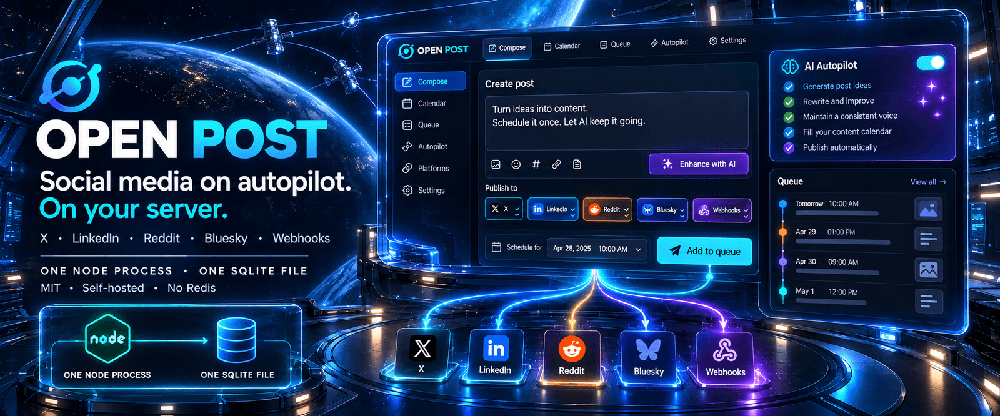
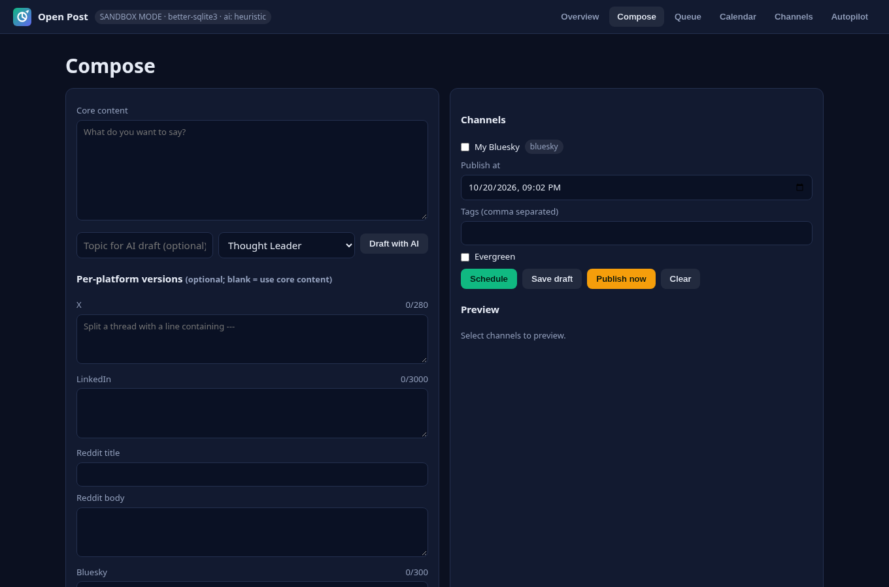
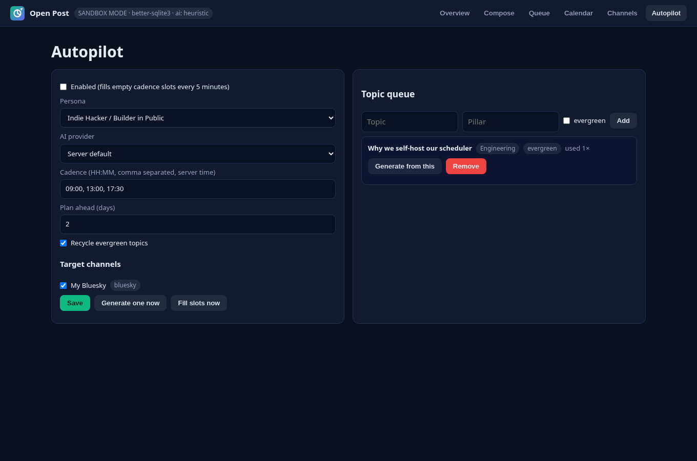
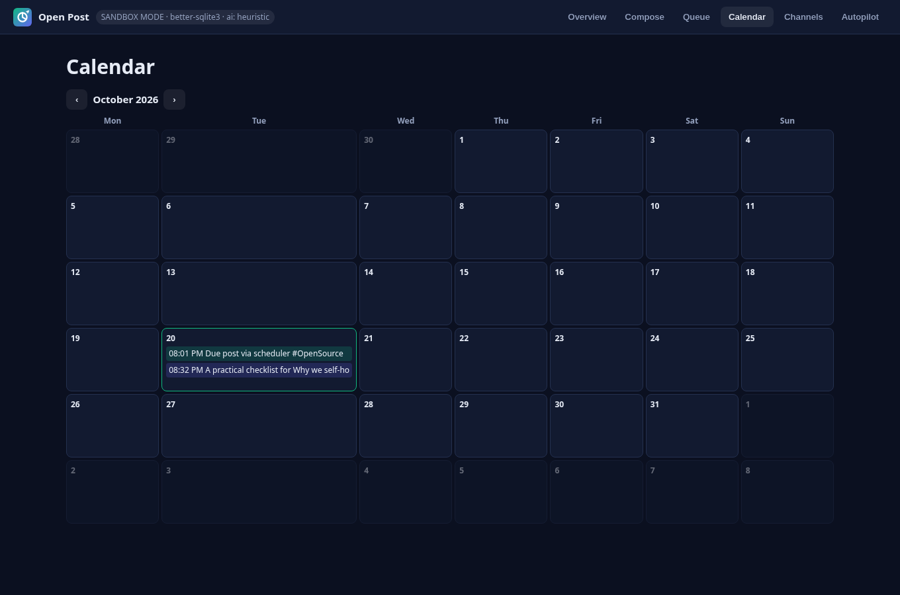
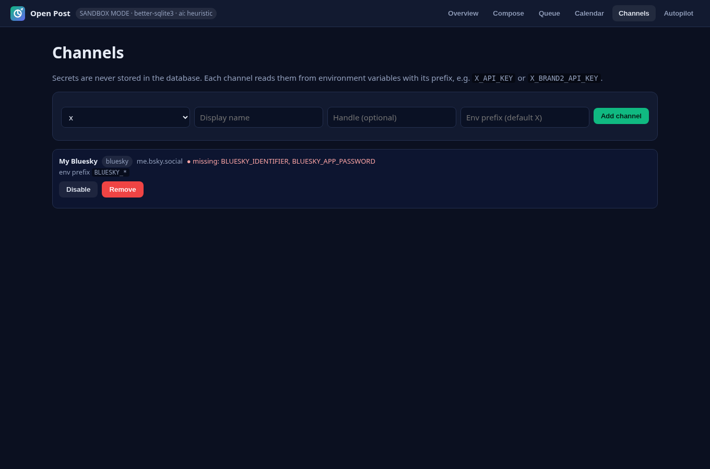

<div align="center">



# Open Post

**Run your social media on autopilot, on your own server.**

A free, MIT-licensed, self-hosted social media scheduler and AI autopilot for **X, LinkedIn, Reddit, Bluesky and webhooks**.<br>
It's one Node.js process with one SQLite file. No Redis, no Temporal, no paid tier.

[](https://github.com/CodesbyFebin/Open-Post/actions/workflows/ci.yml)
[](https://codesbyfebin.github.io/Open-Post/)
[](LICENSE)
[](package.json)
[](openapi.yaml)
[](https://github.com/CodesbyFebin/Open-Post/stargazers)

[**Website**](https://codesbyfebin.github.io/Open-Post/) ·
[**Quickstart**](#-quickstart) ·
[**Docs / Wiki**](https://github.com/CodesbyFebin/Open-Post/wiki) ·
[**API**](openapi.yaml) ·
[**Compare vs Postiz**](#-open-post-vs-postiz) ·
[**FAQ**](#-faq)


</div>

---

## Table of contents

- [Why Open Post?](#-why-open-post)
- [Features](#-features)
- [Quickstart](#-quickstart)
- [Your first post in five minutes](#-your-first-post-in-five-minutes)
- [Connecting real channels](#-connecting-real-channels)
- [Autopilot](#-autopilot)
- [AI providers](#-ai-providers)
- [Configuration reference](#-configuration-reference)
- [REST API](#-rest-api)
- [How it works](#-how-it-works)
- [Deployment](#-deployment)
- [Security](#-security)
- [Open Post vs Postiz](#-open-post-vs-postiz)
- [Roadmap](#-roadmap)
- [FAQ](#-faq)
- [Contributing](#-contributing)
- [License](#-license)

---

## 💡 Why Open Post?

Most social media schedulers fall into one of two camps. Hosted SaaS tools charge per channel or per seat and keep your content on their servers. The open-source alternatives are often full platforms that need PostgreSQL, Redis, a workflow engine and several containers before you can schedule a single post.

Open Post is for people who want **just enough**:

- **Write once, publish everywhere.** Write a post once, tweak it per platform if you like, and pick a time. Open Post publishes it to every channel you selected and logs exactly what happened on each one.
- **Autopilot when you're busy.** Give it a list of topics and a few daily time slots. It drafts posts, with an LLM or its offline template engine, and keeps your calendar filled.
- **Own everything.** Your posts live in a single SQLite file on your machine, and your API keys live in environment variables. There are no accounts to create and nothing phones home.
- **Small enough to understand.** The whole backend is a handful of files and has one runtime dependency (Express). You can read it in an afternoon and change anything.

It runs happily on a small VPS, a Raspberry Pi, a home server or your laptop. We measured about **70 MB RSS** at idle on Node 20.

> **Status:** v1.1 is a young project. Everything described in this README is implemented and covered by tests. Planned features are listed in the [roadmap](#-roadmap) and labelled as such. Nothing in the app is mocked. See [AUDIT.md](AUDIT.md) for how the original prototype's mock data was removed.

---

## ✨ Features

### Scheduling and publishing

- **Universal composer** with optional per-platform versions for X, LinkedIn, Reddit (title and body) and Bluesky
- **Live character counters** for X (280), Bluesky (300) and LinkedIn (3000). Posts over a limit are rejected, never silently cut
- **X threads**: put a line containing `---` between parts and they're posted as a reply chain
- **Queue and calendar views**: filter by status, edit, reschedule, publish now, or click a calendar day to schedule
- **Delivery log per channel**, with remote IDs and links to the live post
- **Automatic retries** with exponential backoff (1 → 2 → 4 minutes). Only the channels that failed are retried
- **Clear post states**: `draft`, `scheduled`, `publishing`, `published`, `partial`, `failed`

### Channels

| Network | How Open Post publishes | Auth |
| --- | --- | --- |
| **X (Twitter)** | API v2 `POST /2/tweets`, threads as reply chains | OAuth 1.0a user context (HMAC-SHA1 signed), or an OAuth 2.0 user token |
| **LinkedIn** | UGC Posts API, for members or organization pages | OAuth 2.0 access token plus author URN |
| **Reddit** | `/api/submit` self posts to any subreddit | Script-app password grant, or an access token |
| **Bluesky** | AT Protocol `createRecord`, with link and hashtag facets | Handle plus App Password |
| **Webhook** | JSON `POST`, signed with HMAC-SHA256 | Optional shared secret |
| **Sandbox** | Records a delivery without any network call | None |

You can run **multiple accounts per network** by giving each channel its own env prefix (for example `X_BRAND2_API_KEY`).

### Autopilot

- **Cadence slots** (e.g. `09:00, 13:00, 17:30`), planned 1–14 days ahead without double-booking
- **Topic queue** with content pillars. **Evergreen topics** are recycled when the one-off ideas run out
- **Five personas**: Thought Leader, Indie Hacker / Builder in Public, Technical Architect, Contrarian Analyst, Viral Storyteller
- **Platform-tailored output**: one idea becomes an X post, a LinkedIn post, a Reddit title and body, and a Bluesky post
- **Transparent**: every generated post records which engine wrote it and, if a provider failed, why it fell back

### AI providers

- **OpenAI** (and any OpenAI-compatible endpoint), **Anthropic**, **Google Gemini**, and **Ollama** for fully local models
- **Built-in heuristic engine** that needs no API key and no network, and gives deterministic output

### Operations

- **Storage**: built-in `node:sqlite` on Node 22+, `better-sqlite3`, or an atomic JSON file. Detected automatically
- **Sandbox mode** for safe end-to-end testing (`SANDBOX_MODE=true`)
- **Optional API token** that protects the API and dashboard
- **Docker image** runs as a non-root user with a healthcheck
- **`cli.js tick`** for cron or serverless-style runs
- **OpenAPI 3.1 spec**, **llms.txt** and **CITATION.cff** for tools and agents

<table>
<tr>
<td></td>
<td></td>
</tr>
<tr>
<td align="center"><sub>Composer</sub></td>
<td align="center"><sub>Autopilot</sub></td>
</tr>
<tr>
<td></td>
<td></td>
</tr>
<tr>
<td align="center"><sub>Calendar</sub></td>
<td align="center"><sub>Channels: shows which env vars are missing, never the values</sub></td>
</tr>
</table>

---

## 🚀 Quickstart

### Option 1: Docker Compose (recommended)

```bash
git clone https://github.com/CodesbyFebin/Open-Post.git
cd Open-Post
cp .env.example .env
# for a first, risk-free run:
sed -i 's/^SANDBOX_MODE=false/SANDBOX_MODE=true/' .env
docker compose up -d --build
```

Open **http://localhost:3000**.

### Option 2: Node.js 20.12+ (22 LTS recommended)

```bash
git clone https://github.com/CodesbyFebin/Open-Post.git
cd Open-Post
npm install
cp .env.example .env
npm start
```

### Check that it's running

```bash
curl http://localhost:3000/api/health
# {"status":"ok","app":"open-post","version":"1.1.0","store":"node:sqlite","sandboxMode":true,...}
```

The `store` field shows which storage engine was picked: `node:sqlite`, `better-sqlite3` or `json`.

---

## 🧭 Your first post in five minutes

1. **Start in sandbox mode** (`SANDBOX_MODE=true`). The header shows `SANDBOX MODE` so you always know nothing is going out.
2. **Add a channel.** Open **Channels**, pick `sandbox` (or any real type) and give it a name.
3. **Compose.** Open **Compose**, write something, tick the channel and pick a time a minute or two from now. Then click **Schedule**.
4. **Watch it go out.** The scheduler checks every 30 seconds. In **Queue**, the post changes to `published` and the delivery log shows `sandbox (not sent)`.
5. **Go live.** Add the credentials for a real network to `.env` (see below), set `SANDBOX_MODE=false`, restart, and publish for real.

Prefer the terminal? Here's the same flow with `curl`:

```bash
B=http://localhost:3000
CH=$(curl -s -X POST $B/api/channels -H 'Content-Type: application/json' \
      -d '{"type":"sandbox","name":"Try it"}' | node -pe 'JSON.parse(require("fs").readFileSync(0)).id')

curl -s -X POST $B/api/posts -H 'Content-Type: application/json' \
  -d "{\"content\":\"Hello from Open Post\",\"channelIds\":[\"$CH\"]}" > /tmp/post.json

curl -s -X POST $B/api/posts/$(node -pe 'require("/tmp/post.json").id')/publish-now
```

---

## 🔌 Connecting real channels

Open Post **never stores secrets in its database**. Each channel reads its credentials from environment variables named `<PREFIX>_<KEY>`. The dashboard shows which variables are still missing. It shows only the names, never the values.

| Type | Default prefix | Required variables |
| --- | --- | --- |
| `x` | `X` | `X_API_KEY`, `X_API_SECRET`, `X_ACCESS_TOKEN`, `X_ACCESS_SECRET`, **or** `X_OAUTH2_USER_TOKEN` |
| `linkedin` | `LINKEDIN` | `LINKEDIN_ACCESS_TOKEN`, `LINKEDIN_AUTHOR_URN` |
| `reddit` | `REDDIT` | `REDDIT_CLIENT_ID`, `REDDIT_CLIENT_SECRET`, `REDDIT_USERNAME`, `REDDIT_PASSWORD` **or** `REDDIT_ACCESS_TOKEN`, plus a subreddit on the channel |
| `bluesky` | `BLUESKY` | `BLUESKY_IDENTIFIER`, `BLUESKY_APP_PASSWORD` (optional `BLUESKY_SERVICE`) |
| `webhook` | `WEBHOOK` | URL on the channel or `WEBHOOK_URL`, optional `WEBHOOK_SECRET` |
| `sandbox` | — | none |

**Quick notes for each network** (the [Channels wiki page](https://github.com/CodesbyFebin/Open-Post/wiki/Channels) has step-by-step instructions):

- **X**: your app needs *Read and write* permission. Regenerate the access token after changing permissions. An app-only Bearer token **can't** create posts. X's API tiers and pricing change, so check that your plan allows writes.
- **LinkedIn**: use a token with `w_member_social` (personal) or `w_organization_social` (company page). The author is `urn:li:person:<id>` or `urn:li:organization:<id>`. Tokens usually expire after about 60 days.
- **Reddit**: create a *script* app at reddit.com/prefs/apps, and set a descriptive `REDDIT_USER_AGENT`. Each subreddit's rules still apply.
- **Bluesky**: use an **App Password**, never your main password. Links and `#hashtags` become clickable automatically.
- **Webhooks**: perfect for n8n, Make, Zapier or your own service. Each request carries `X-Open-Post-Signature: sha256=<hmac>`, so you can verify it came from you.

**Multiple accounts:** create a second X channel with env prefix `X_BRAND2` and set `X_BRAND2_API_KEY`, `X_BRAND2_API_SECRET`, `X_BRAND2_ACCESS_TOKEN` and `X_BRAND2_ACCESS_SECRET`.

---

## 🤖 Autopilot

Autopilot turns a list of ideas into a steady posting schedule.

1. **Add topics** in the Autopilot tab, e.g. *"What we learned migrating to SQLite"* (pillar: Engineering). Tick **evergreen** for topics that are fine to revisit.
2. **Pick a persona** to set the tone of voice.
3. **Choose target channels** and **cadence slots**, e.g. `09:00, 18:00`. Slots use the server's local time, so set `TZ`.
4. **Enable it.** Every five minutes Open Post looks `horizonDays` ahead, finds empty slots, picks the least-used eligible topic, drafts a post and schedules it.

Autopilot posts are normal scheduled posts. **You can review, edit or delete them before they're due.** If you'd rather approve everything by hand, leave autopilot disabled and press **Fill slots now** or **Generate one now** when you want drafts.

When the queue is empty, autopilot simply stops. It never makes up topics.

---

## 🧠 AI providers

| `AI_PROVIDER` | You need | Notes |
| --- | --- | --- |
| `heuristic` *(default)* | nothing | Offline, deterministic templates. A good fallback and fine for testing |
| `openai` | `OPENAI_API_KEY` | JSON mode, default model `gpt-4o-mini`. `OPENAI_BASE_URL` lets you use any compatible gateway |
| `anthropic` | `ANTHROPIC_API_KEY` | Messages API, default `claude-3-5-haiku-latest` |
| `gemini` | `GEMINI_API_KEY` | `generateContent` with JSON output, default `gemini-1.5-flash` |
| `ollama` | a running Ollama | Fully local, default `llama3.1` (`ollama pull llama3.1`) |

Override the model with `AI_MODEL`. The prompt asks for a core post plus variants for X, LinkedIn, Reddit and Bluesky, and tells the model **not to invent statistics, customers or testimonials**. If a provider errors or returns invalid JSON, Open Post uses the heuristic engine and saves the reason in `meta.fallbackReason`. The UI shows it too, so silent failures are impossible.

---

## ⚙️ Configuration reference

Configuration lives in environment variables, usually a `.env` file. [`.env.example`](.env.example) lists all of them with comments. The most important ones:

| Variable | Default | What it does |
| --- | --- | --- |
| `PORT` / `HOST` | `3000` / `0.0.0.0` | Where the server listens |
| `DATA_DIR` | `./data` | Where the database file lives |
| `STORE_DRIVER` | `auto` | `auto`, `sqlite` or `json` |
| `TZ` | system | Time zone for cadence slots |
| `API_TOKEN` | — | Require `Authorization: Bearer …` on the API |
| `SANDBOX_MODE` | `false` | Send every channel to the sandbox |
| `SCHEDULER_INTERVAL_MS` | `30000` | How often due posts are checked |
| `SCHEDULER_DISABLED` | `false` | Turn the in-process scheduler off (use `cli.js tick`) |
| `MAX_PUBLISH_ATTEMPTS` | `3` | Retries before `failed` / `partial` |
| `AI_PROVIDER` / `AI_MODEL` | `heuristic` | Content engine |
| `CORS_ORIGIN` | — | Allow a separate front-end origin |

---

## 🛠 REST API

The dashboard uses the same API you do. The full spec is in [`openapi.yaml`](openapi.yaml), and you can load it into Swagger UI, Postman, Insomnia or an AI agent.

| Method | Path | Description |
| --- | --- | --- |
| `GET` | `/api/health` | Status, version, storage engine, sandbox flag |
| `GET` | `/api/config` | Channel types, personas, AI provider |
| `GET` `POST` | `/api/channels` | List or create channels |
| `GET` `PUT` `DELETE` | `/api/channels/:id` | Manage one channel |
| `GET` `POST` | `/api/posts` | List (`?status=&channelId=&from=&to=`) or create posts |
| `GET` `PUT` `DELETE` | `/api/posts/:id` | Manage one post |
| `POST` | `/api/posts/:id/publish-now` | Publish immediately |
| `GET` `PUT` | `/api/autopilot` | Read or update autopilot settings |
| `POST` | `/api/autopilot/generate-now` | Generate and schedule one post |
| `POST` | `/api/autopilot/fill` | Fill every empty cadence slot |
| `POST` | `/api/generate` | Draft content without saving it |
| `GET` | `/api/analytics` | Counts computed from your database |

Example: schedule a post that goes out as a two-part thread on X and a single post elsewhere:

```bash
curl -X POST http://localhost:3000/api/posts -H 'Content-Type: application/json' -d '{
  "content": "We just shipped Open Post 1.1: real drivers, SQLite and autopilot.",
  "platformOverrides": {
    "x": { "content": "We just shipped Open Post 1.1 🚀\n---\nReal X, LinkedIn, Reddit and Bluesky drivers, SQLite storage and an autopilot that fills your calendar." },
    "reddit": { "title": "Open Post 1.1: a tiny self-hosted social scheduler" }
  },
  "channelIds": ["ch_x...", "ch_bsky...", "ch_reddit..."],
  "scheduledFor": "2026-11-01T09:00:00+05:30",
  "tags": ["release"]
}'
```

---

## 🏗 How it works

```
┌──────────────── one Node.js process ────────────────┐
│                                                     │
│  Dashboard (public/)  ──►  REST API (src/app.js)    │
│                               │                     │
│                     Service (src/service.js)        │
│              posts · channels · retries · autopilot │
│                 │              │             │      │
│        Store (src/store.js)  Drivers       LLM      │
│        SQLite / JSON file    X · LinkedIn  OpenAI · │
│                              Reddit ·      Anthropic│
│   Scheduler (setInterval)    Bluesky ·     Gemini · │
│   fill slots → dispatch due  Webhook ·     Ollama · │
│                              Sandbox       Heuristic│
└─────────────────────────────────────────────────────┘
```

- **No queue server.** A single timer ticks every 30 seconds. A guard stops two ticks from overlapping, and an in-flight lock stops a post from being published twice.
- **No ORM.** Records are JSON documents in a single SQLite table keyed by `(collection, id)`, so the same code runs on SQLite or a JSON file.
- **Drivers are plain functions** of `(channel, post, { fetch, env })`. The tests inject a fake `fetch` and check the exact HTTP request each network receives.

---

## ☁️ Deployment

- **Any VPS or home server**: Docker Compose, or Node with systemd. See the [Installation](https://github.com/CodesbyFebin/Open-Post/wiki/Installation) and [Deployment](https://github.com/CodesbyFebin/Open-Post/wiki/Deployment) wiki pages.
- **Behind HTTPS**: put Caddy or Nginx in front, set `HOST=127.0.0.1` and **set `API_TOKEN`**.
- **Backups**: `sqlite3 data/open-post.db ".backup backup.db"`, or copy `data/open-post.json`.
- **One instance per data directory.** The scheduler is in-process.
- **Hosts that sleep idle containers** will pause the scheduler too. Use an always-on host, or trigger `node cli.js tick` from cron.

---

## 🔒 Security

- Secrets come **only** from environment variables. The API rejects `credentials` in channel payloads and never returns secret values.
- Setting `API_TOKEN` protects the API and dashboard with a constant-time token check.
- Webhooks are HMAC-signed when `WEBHOOK_SECRET` is set.
- Open Post is single-tenant. Anyone with API access can post to every connected channel, so keep it private or token-protected.
- Report vulnerabilities privately. See [SECURITY.md](SECURITY.md).

---

## ⚖️ Open Post vs Postiz

[Postiz](https://github.com/gitroomhq/postiz-app) is a mature, full-featured open-source scheduler, and if you need what it offers, it's a great choice. Open Post makes different trade-offs:

| | **Open Post** | **Postiz** |
| --- | --- | --- |
| License | MIT | AGPL-3.0 |
| Services to run | 1 Node process plus a SQLite file | App, PostgreSQL 14+, Redis 6+, Temporal (required since v2.12.0) |
| Hardware | ~70 MB RSS measured at idle | 2 GB RAM floor, 8 GB recommended (per Postiz docs) |
| Networks | X, LinkedIn, Reddit, Bluesky, webhooks | Many more, including Instagram, Facebook, TikTok, YouTube, Threads and Mastodon |
| Teams and multiple users | No (single-tenant) | Yes |
| Media uploads | Not yet | Yes |
| Hosted option | No | Yes (Postiz Cloud) |
| AI | OpenAI, Anthropic, Gemini, Ollama, offline heuristic | Built-in AI features |

<sub>The Postiz column comes from its self-hosting documentation (System Requirements and Configuration Reference), checked in October 2026. If something has changed, please open an issue.</sub>

**Choose Open Post** if you post to a few networks as one person or a small team, want tiny resource usage, or want code you can read end to end. **Choose Postiz** if you need many networks, media, team workflows or a hosted service.

---

## 🗺 Roadmap

These are planned and **not implemented yet**:

- [ ] Image and video uploads (X, LinkedIn, Bluesky blobs)
- [ ] OAuth "Connect" buttons as an alternative to env vars
- [ ] Mastodon and Threads drivers
- [ ] Engagement metrics pulled back from each network
- [ ] Per-slot channel targeting and per-day cadences
- [ ] Approval queue for autopilot posts
- [ ] Prebuilt container image on GHCR

Want one of these? Comment on or open an issue, or send a PR.

---

## ❓ FAQ

<details>
<summary><b>Is it really free?</b></summary>

Yes. It's MIT licensed with no tiers, seats, telemetry or license keys. You pay only for your own hosting, and for any paid platform APIs or LLMs you choose to use.
</details>

<details>
<summary><b>Why env vars instead of a "Connect account" button?</b></summary>

A connect button needs a registered OAuth app per network and a public callback URL on your server. Env vars work everywhere, keep tokens out of the database, and are easy to rotate. Built-in OAuth flows are on the roadmap.
</details>

<details>
<summary><b>The channel says "missing env vars". What now?</b></summary>

The card lists the exact variable names. Add them to `.env` and restart the server. The check shows only names, never values.
</details>

<details>
<summary><b>My X post fails with 401/403.</b></summary>

Give your X app *Read and write* permission, regenerate the access token and secret afterwards, and use OAuth 1.0a user keys or an OAuth 2.0 *user* token. App-only Bearer tokens can't create posts. Also check that your API plan allows writes.
</details>

<details>
<summary><b>How do I test without posting anything?</b></summary>

Set `SANDBOX_MODE=true`, or create a `sandbox` channel. Sandbox deliveries are labelled clearly and never include fake links.
</details>

<details>
<summary><b>Can I run it fully offline or with a local model?</b></summary>

Yes. The heuristic engine needs no network, and `AI_PROVIDER=ollama` uses a local model. Publishing itself obviously needs to reach the social networks.
</details>

<details>
<summary><b>Which time zone do cadence slots use?</b></summary>

The server's local time. Set `TZ`, for example `TZ=Asia/Kolkata` or `TZ=America/New_York`.
</details>

<details>
<summary><b>What happens if a network is down?</b></summary>

The failed channels are retried after 1, 2 and 4 minutes (configurable with `MAX_PUBLISH_ATTEMPTS`). Channels that already succeeded aren't posted again. After the last attempt, the post is marked `partial` or `failed`, and the error is shown in the queue.
</details>

<details>
<summary><b>Can I run several instances for redundancy?</b></summary>

Not against the same data directory. The scheduler lock is in-process. Run one instance under a supervisor that restarts it.
</details>

<details>
<summary><b>Does it post images?</b></summary>

Not yet. It posts text only. Media support is the top roadmap item.
</details>

<details>
<summary><b>Where is my data stored?</b></summary>

In `DATA_DIR` (default `./data`), as `open-post.db` (SQLite) or `open-post.json`.
</details>

<details>
<summary><b>Is the original single-file HTML app still available?</b></summary>

It was replaced by the API-backed dashboard in `public/`, because it kept everything in `localStorage` and never actually published. It's still in the git history (commit `6dceaef`). See [AUDIT.md](AUDIT.md).
</details>

---

## 🤝 Contributing

Contributions of all sizes are welcome: bug reports, docs fixes, new drivers and UI polish.

```bash
npm install
npm test        # node --test
npm run lint    # eslint
npm run dev     # auto-restart on changes
```

Please read [CONTRIBUTING.md](CONTRIBUTING.md) and follow the [Code of Conduct](CODE_OF_CONDUCT.md). Good first contributions: a Mastodon driver, media uploads for Bluesky, translations for the dashboard, and more tests.

If Open Post saves you time, **starring the repo** helps other people find it.

---

## 📜 License

[MIT](LICENSE). Free for personal and commercial use.

<div align="center"><sub>Built with care by <a href="https://github.com/CodesbyFebin">@CodesbyFebin</a> and contributors.</sub></div>
